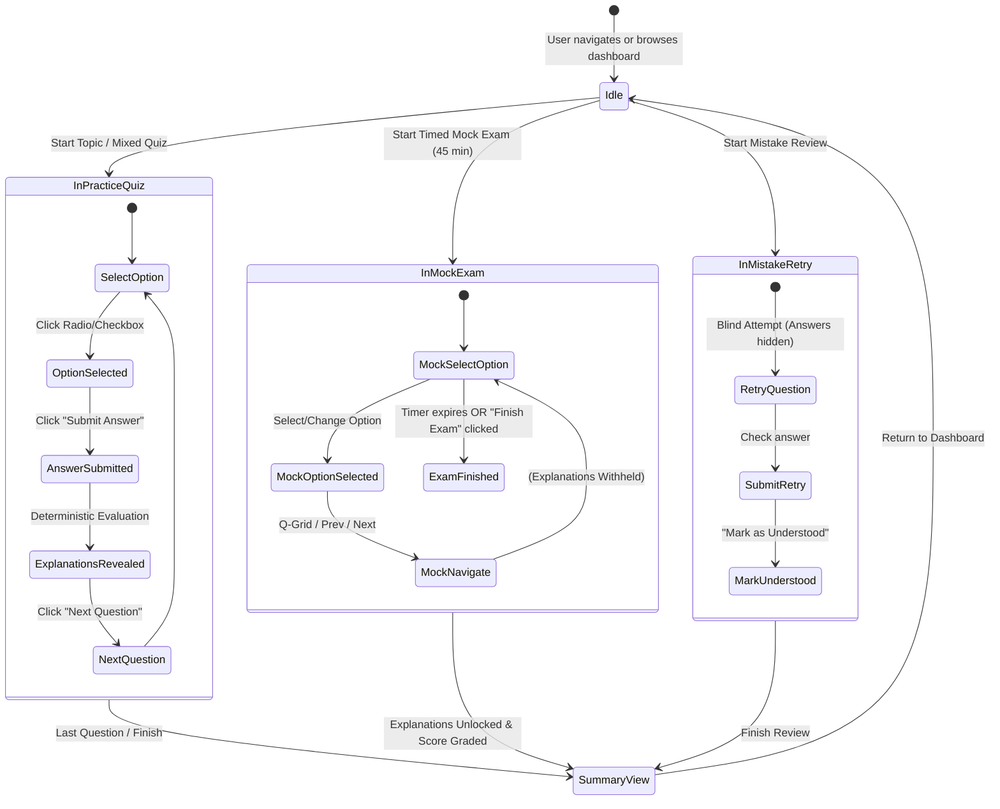
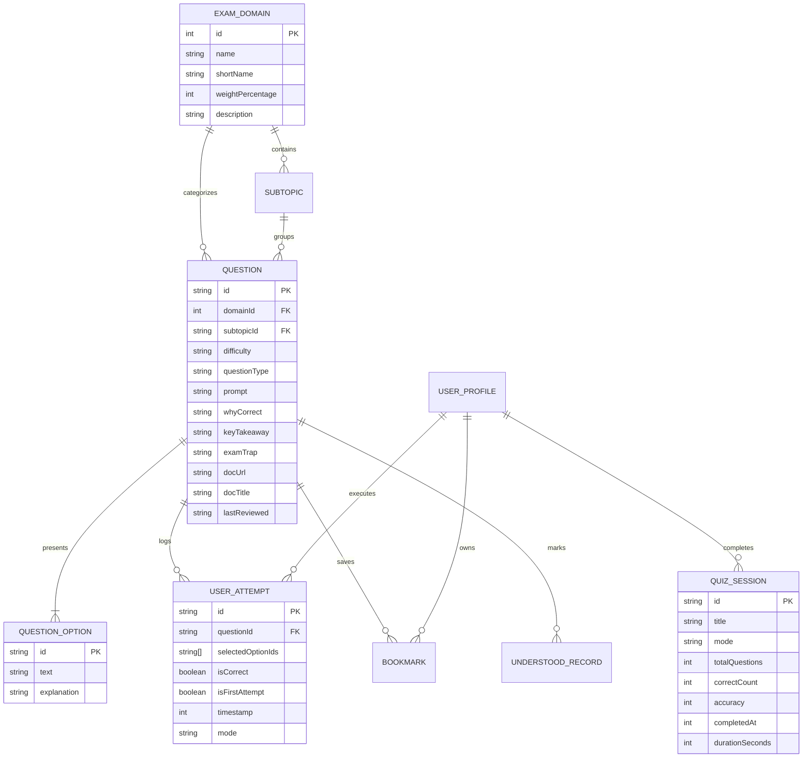

# AzurePrep — Learn the Why
### Interactive Microsoft Azure Fundamentals (AZ-900) Certification Platform

> **Core Philosophy:** *Every question should teach something, regardless of whether the learner gets it right or wrong.*

---

## ⚠️ Important Disclaimer

**AzurePrep is an independent educational tool developed to help learners understand cloud computing and prepare for the AZ-900 certification exam.**

- **Not an Official Tool:** This application is **not** affiliated with, endorsed by, sponsored by, or produced by Microsoft Corporation.
- **Trademarks:** *Microsoft*, *Azure*, *Microsoft Entra ID*, *Microsoft Defender*, *Microsoft Purview*, and any related product or service names are registered trademarks of Microsoft Corporation.
- **Exam Scores:** Practice questions, assessments, and mock examination scores generated within this application are strictly for diagnostic and learning purposes. Performance in AzurePrep does not guarantee a passing score on the official Microsoft AZ-900 proctored certification exam.

---

## 📖 Table of Contents

1. [Product Overview & Problem Statement](#-product-overview--problem-statement)
2. [Architectural Overview & Diagrams](#-architectural-overview--diagrams)
   - [System Component Architecture](#system-component-architecture)
   - [Quiz Engine State Machine](#quiz-engine-state-machine)
   - [Data Model & Entity Relationships](#data-model--entity-relationships)
3. [Key Features](#-key-features)
4. [AZ-900 Exam Domain Structure](#-az-900-exam-domain-structure)
5. [Data Schemas & Type Definitions](#-data-schemas--type-definitions)
6. [How-To Guide](#-how-to-guide)
   - [Taking a Topic-Focused Quiz](#1-taking-a-topic-focused-quiz)
   - [Taking a Timed Mock Exam](#2-taking-a-timed-mock-exam)
   - [Reviewing & Retrying Mistakes](#3-reviewing--retrying-mistakes)
   - [Bookmarking & Custom Practice](#4-bookmarking--custom-practice)
   - [Configuring Domain Weights](#5-configuring-domain-weights)
   - [Backing Up and Restoring Progress](#6-backing-up-and-restoring-progress)
7. [Technologies Used](#-technologies-used)
8. [Testing & Content Integrity](#-testing--content-integrity)
9. [Local Development & Setup](#-local-development--setup)

---

## 🎯 Product Overview & Problem Statement

### The Problem
When studying for entry-level cloud credentials like the AZ-900, many students drill static multiple-choice question dumps. They memorise letter answers (`A`, `C`, etc.) without understanding *why* the answer is correct or *why* the alternative options fail. As soon as Microsoft slightly rephrases the scenario in the real exam, rote learners struggle.

### The Solution
**AzurePrep — Learn the Why** transforms quiz practice into a guided learning experience:
- **Option-Specific Feedback:** Rather than generic *"Incorrect, try again"* messages, every distractor is thoroughly unpacked with its actual Azure purpose and why it does not fit the scenario.
- **Dual Accuracy Tracking:** Separates **First-Attempt Accuracy** from repeated retries, preventing the illusion of mastery from repeated exposure.
- **Spaced Mistake Review:** Retains every missed question in an isolated error ledger until the learner retries and marks it as understood.
- **Configurable Exam Simulation:** Mimics the official 45-minute AZ-900 test environment with explanations locked until submission.

---

## 🏗️ Architectural Overview & Diagrams

### System Component Architecture

```mermaid
graph TD
    subgraph UI_Layer [User Interface Layer (React 19 + Tailwind CSS)]
        Nav[Navbar & Global Stats Pill]
        Dash[Learning Dashboard & Recommendations]
        TopicView[Practise by Topic Browser]
        MixedView[Mixed Practice Configurator]
        MockView[Timed Mock Exam Launcher]
        MistakesView[Review My Mistakes & Retry Hub]
        BookmarksView[Bookmarked Questions Deck]
        AnalyticsView[Progress & Telemetry View]
        Modals[Weights & Profile Modals]
    end

    subgraph Core_Engine [Interactive Quiz Engine]
        QE[QuizEngine Component]
        QPalette[Question Palette & Navigation Grid]
        EvalView[Option Breakdown & Reinforcement Card]
        QSummary[QuizSummary & Domain Breakdown Card]
    end

    subgraph State_Management [Context & Pure Logic]
        QContext[QuizContext Provider]
        LogicUtils[Pure Logic Utilities (quizLogic.ts)]
        EvalEngine[evaluateAnswer]
        StatCalc[calculateTopicStats & calculateOverallStats]
        Sampler[sampleMockExamQuestions]
    end

    subgraph Data_Storage [Persistent Storage & Content Bank]
        QBank[(Verified AZ-900 Question Bank (36 Qs))]
        DomainsCfg[(Official Exam Domains Config)]
        LocalStorage[(Browser LocalStorage Engine)]
    end

    Nav --> QContext
    Dash --> QContext
    TopicView --> QContext
    MixedView --> QContext
    MockView --> QContext
    MistakesView --> QContext
    BookmarksView --> QContext
    AnalyticsView --> QContext
    Modals --> QContext

    QContext --> QE
    QE --> QPalette
    QE --> EvalView
    QE --> QSummary

    QContext --> LogicUtils
    LogicUtils --> EvalEngine
    LogicUtils --> StatCalc
    LogicUtils --> Sampler

    QContext --> QBank
    QContext --> DomainsCfg
    QContext <--> LocalStorage
```

---

### Quiz Engine State Machine



---

### Data Model & Entity Relationships



---

## ✨ Key Features

### 1. Deep Concept Explanations ("Learn the Why")
- **Option-Specific Breakdown:** Each option (A, B, C, D) renders an individual card explaining why it is correct or what that specific Azure technology actually does and why it is disqualified.
- **Key Takeaways:** A concise *“Remember This”* principle distilling the core AZ-900 exam rule.
- **Common Exam Traps:** Warnings on frequent pitfalls (e.g. *confusing Azure Policy with Azure RBAC*, or *confusing Availability Zones with Region Pairs*).
- **Official Documentation Links:** Active hyperlinks leading directly to relevant pages on [Microsoft Learn](https://learn.microsoft.com).

### 2. Official 3-Domain Question Bank
- Pre-seeded with **36 authentic, peer-reviewed practice questions** strictly aligned with the latest Microsoft AZ-900 exam syllabus.
- No generic AI-slop; every question is factually verified with real Azure capabilities and zero deprecated terminology (e.g. *Microsoft Entra ID* is used instead of legacy *Azure AD*).

### 3. Dual-Accuracy Learning Telemetry
- **First-Attempt Accuracy:** Tracks how well you perform on questions you have never seen before.
- **Overall Practice Accuracy:** Tracks total submissions, including retries.
- **Conservative Mastery Guardrails:** The platform avoids declaring a topic "Mastered" on 1 or 2 lucky guesses; at least 3 attempts are required to classify a domain or subtopic as *Mastered*, *Developing*, or *Needs Focus*.

### 4. Dedicated Mistake Review Hub
- Tracks every question you get wrong across practice quizzes and mock exams.
- Allows **blind retries** (practising without the answer pre-highlighted).
- Lets you mark concepts as *Understood* once you have mastered the underlying mechanism.
- Filter by *Repeated Mistakes* (questions missed 2 or more times) to eliminate stubborn knowledge gaps.

### 5. Official Timed Mock Examination
- **Official Weight Distribution:** Samples questions proportionally across the three official exam domains (25% / 40% / 35%).
- **Explanations Withheld:** Answers and explanations are locked while the 45-minute countdown timer runs.
- **Post-Exam Score Report:** Evaluates performance against the official **700 / 1000 (70%)** Microsoft passing benchmark and gives a domain-by-domain diagnostic.

### 6. Configurable Domain Weights (Admin Feature)
- If Microsoft updates its study guide weightings, users and instructors can modify domain percentages directly via the **Adjust Weights** modal.
- Built-in presets for *Official Guide (25/40/35)*, *Equal Weight (33/34/33)*, and *Architecture-Heavy (20/50/30)*.

### 7. Local-First & Zero-Friction Guest Access
- Start learning immediately with no mandatory account creation or credit card walls.
- Full offline-tolerant persistence via `localStorage`.
- Comprehensive **JSON Export & Import** allowing you to transfer your progress, attempt logs, and bookmarks between browsers and devices.

---

## 📚 AZ-900 Exam Domain Structure

The questions and topic analytics in AzurePrep adhere to the three official domains:

| Domain ID | Official Microsoft AZ-900 Domain | Default Exam Weight | Key Subtopics Covered |
|:---:|:---|:---:|:---|
| **Domain 1** | **Describe cloud concepts** | **25%** | Cloud computing fundamentals, Shared Responsibility Model, Public / Private / Hybrid cloud models, CapEx vs. OpEx, Consumption pricing, High availability, Scalability vs. Elasticity, Reliability, Geo-distribution. |
| **Domain 2** | **Describe Azure architecture and services** | **40%** | Regions, Availability Zones, Region Pairs, Management hierarchy (Management Groups → Subscriptions → Resource Groups → Resources), Azure Compute (VMs, AKS, ACI, Functions, App Service), Networking (VNets, ExpressRoute, VPN Gateway, Peering), Storage (Blob access tiers, LRS, ZRS, GRS), Microsoft Entra ID, Azure RBAC, Zero Trust security, Defender for Cloud. |
| **Domain 3** | **Describe Azure management and governance** | **35%** | Cost Management & Pricing Calculator, Azure Hybrid Benefit, Azure Policy & Initiatives, Resource Locks (CanNotDelete vs. ReadOnly), Resource Tags, Microsoft Purview, Azure Monitor, Log Analytics, Application Insights, Azure Service Health vs. Azure Status, Azure Advisor, ARM templates & Bicep, Azure Cloud Shell & CLI. |

---

## 🗄️ Data Schemas & Type Definitions

The TypeScript models are defined in `src/types/quiz.ts`:

### Question & Option Schema
```typescript
export interface QuestionOption {
  id: string;          // 'A' | 'B' | 'C' | 'D'
  text: string;        // The option answer text
  explanation: string; // Specific factual reason why this choice succeeds or fails
}

export interface Question {
  id: string;                            // e.g. 'az900-d1-001'
  domainId: 1 | 2 | 3;
  domainName: string;
  subtopicId: string;
  subtopicName: string;
  difficulty: 'Beginner' | 'Intermediate' | 'Exam-level';
  questionType: 'single' | 'multiple';
  prompt: string;
  codeSnippet?: string;
  options: QuestionOption[];
  correctOptionIds: string[];            // e.g. ['B'] or ['A', 'C']
  whyCorrect: string;                    // Deep concept explanation
  keyTakeaway: string;                   // 'Remember this' rule
  examTrap?: string;                     // Frequent candidate pitfall
  practicalAnalogy?: string;             // Everyday real-world analogy
  docUrl: string;                        // Active Microsoft Learn URL
  docTitle: string;
  verificationStatus: 'verified' | 'review_needed';
  lastReviewed: string;                  // ISO Date
}
```

### Attempt & Session Schema
```typescript
export interface UserAttempt {
  id: string;
  questionId: string;
  selectedOptionIds: string[];
  isCorrect: boolean;
  isPartial?: boolean;
  isFirstAttempt: boolean;              // Preserved to prevent score inflation
  timestamp: number;
  mode: 'practice' | 'mixed' | 'mock' | 'mistakes' | 'bookmarks';
}

export interface QuizSessionSummary {
  id: string;
  title: string;
  mode: 'practice' | 'mixed' | 'mock' | 'mistakes' | 'bookmarks';
  totalQuestions: number;
  correctCount: number;
  accuracy: number;
  domainId?: number;
  completedAt: number;
  durationSeconds: number;
}
```

---

## 🚀 How-To Guide

### 1. Taking a Topic-Focused Quiz
1. Click **Practise by Topic** in the top navigation.
2. Select one of the three domains (e.g. *Domain 2: Architecture and Services*).
3. Optionally select a specific subtopic (e.g. *Networking: VNets, VPN Gateway & ExpressRoute*).
4. Choose your desired quiz length (5, 10, 15, or 20 questions) and difficulty filter.
5. Click **Start Practice Quiz**.
6. Select your response and click **Submit Answer** to immediately inspect the option-by-option rationale.

### 2. Taking a Timed Mock Exam
1. Click **Mock Exam** in the navigation bar.
2. Review the official exam distribution and parameters (35 questions, 45 minutes).
3. Click **Begin Mock Exam**.
4. Use the **Q-Grid** button in the header to jump between questions or review answered items.
5. Notice that explanations are hidden during the test to simulate real exam pressure.
6. Click **Finish Quiz** (or wait for the timer to expire) to unlock your graded score, pass/fail diagnosis, and full explanation review.

### 3. Reviewing & Retrying Mistakes
1. Click **Review Mistakes** (a warning badge shows your active error count).
2. Filter by:
   - **All Missed:** Every question ever failed.
   - **Needs Practice:** Items not yet marked as understood.
   - **Repeated Mistakes:** Questions missed 2 or more times.
3. Click **Retry Unmastered** to launch a spaced practice session where you re-attempt questions without answers revealed.
4. Click **Mark Understood** once you feel confident in the concept.

### 4. Bookmarking & Custom Practice
1. During any quiz, click the **Bookmark** icon on the top right of the question card.
2. Navigate to the **Bookmarks** tab to view your saved question deck.
3. Click **Practice Saved Questions** to drill your personal collection.

### 5. Configuring Domain Weights
1. Click the **Sliders icon** (`Adjust Weights`) in the top navigation or on the Mock Exam page.
2. Drag the percentage sliders or click one of the quick presets (*Official*, *Equal*, *Architecture*).
3. Verify that the sum equals **100%**.
4. Click **Save Weight Configuration** to update how mock exams sample questions.

### 6. Backing Up and Restoring Progress
1. Navigate to the **Progress** tab.
2. Click **Export Data** to download a `.json` backup of your attempts, bookmarks, and settings.
3. On another device or browser, click **Import** and select the `.json` file to restore your full history.

---

## 💻 Technologies Used

| Technology | Purpose |
|:---|:---|
| **React 19** | Modern UI rendering with functional components and hooks |
| **TypeScript** | Type-safe domain models, evaluations, and state management |
| **Tailwind CSS v4** | Clean, accessible design inspired by Microsoft Learn aesthetic |
| **Vite** | Blazing-fast development server and optimized production bundler |
| **Lucide React** | Clean, accessible SVG iconography |
| **Node.js 22 Test Runner** | Decoupled pure logic unit tests (`node:test`, `node:assert/strict`) |
| **Playwright CLI** | End-to-end headless browser validation across desktop & mobile viewports |

---

## 🧪 Testing & Content Integrity

AzurePrep uses a decoupled, logic-first verification architecture. Pure calculations and question-bank integrity are validated with Node's native test runner without DOM overhead:

### Running Logic Tests
```bash
node --test src/utils/quizLogic.test.ts
```

### What the Test Suite Verifies:
- **`evaluateAnswer`:** Ensures single-choice and multi-select questions grade 100% deterministically, handling full matches, partial selections, and distractor penalties.
- **`calculateTopicStats`:** Asserts that repeat question attempts do not inflate first-attempt accuracy metrics.
- **`sampleMockExamQuestions`:** Proves that questions are sampled accurately according to configurable domain percentages across various quiz lengths.
- **`AZ-900 Question Bank Integrity Check`:** Validates all 36 questions in `az900Questions.ts` to ensure:
  - Every question has an authentic, non-generic explanation for all 4 options.
  - Zero presence of placeholder text (e.g. *"That is incorrect, try again"*).
  - Valid `https://learn.microsoft.com` documentation links.
  - Correct formatting and difficulty tags across all three domains.

---

## 🛠️ Local Development & Setup

### Prerequisites
- **Node.js** version 20+ or 22+
- **npm** or **bun**

### 1. Clone & Install Dependencies
```bash
git clone <repository-url>
cd azureprep
npm install
```

### 2. Run the Development Server
```bash
npm run dev
```
Open [http://localhost:3000](http://localhost:3000) in your browser.

### 3. Run Linting & Type-Checking
```bash
npm run lint
```

### 4. Build for Production
```bash
npm run build
```
The optimized bundle will be compiled to the `/dist` folder ready for deployment.

---

## 📚 Official Microsoft Study References

For authoritative syllabus details and proctored examination registration:
- [Official Microsoft AZ-900 Exam Study Guide](https://learn.microsoft.com/credentials/certifications/resources/study-guides/az-900)
- [Microsoft Learn: Azure Fundamentals Learning Path](https://learn.microsoft.com/training/paths/azure-fundamentals/)
- [Microsoft Security, Compliance, and Identity Documentation](https://learn.microsoft.com/security/)
- [Azure Cloud Adoption Framework](https://learn.microsoft.com/azure/cloud-adoption-framework/)

---
*Built with ❤️ for Azure certification candidates. Happy learning!*
